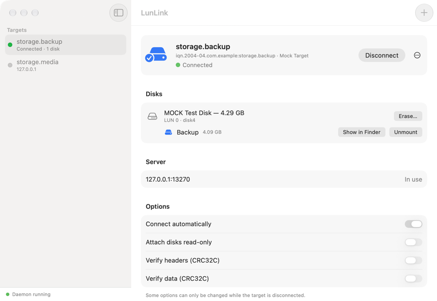

# LunLink

An iSCSI initiator for macOS that runs in user space. It connects a Mac to iSCSI targets (as offered by most NAS devices and storage arrays) and turns their logical units into ordinary disks that can be partitioned, formatted and mounted. For more information about the iSCSI standard, see IETF RFC 7143.

[简体中文说明](README.zh-CN.md)

It is based on the [iSCSI Initiator](https://github.com/iscsi-osx/iSCSIInitiator) of Nareg Sinenian and the iscsi-osx project (see [Origin and credits](#origin-and-credits)), from which it differs in one essential respect: it runs **entirely in user space**. The original relies on a kernel extension, which current versions of macOS no longer load without lowering the security of the system (and not at all in a supported fashion on Apple silicon). LunLink needs

* no kernel extension and no system extension,
* no changes to System Integrity Protection or the boot security policy,
* no administrator privileges, neither to install nor to run,
* nothing but the Xcode Command Line Tools to build.

It consists of a daemon (`iscsid`), a command-line tool (`iscsictl`) and a graphical application (*LunLink*), which carries the other two inside its bundle.



## Requirements

* macOS 13 (Ventura) or later, on Apple silicon or Intel. It was developed and tested on macOS 27 on Apple silicon only; earlier versions and Intel Macs are meant to work but have not been tried.
* To build: the Xcode Command Line Tools (`xcode-select --install`). Xcode itself is not required.

## Building and installing

```sh
make                # builds build/LunLink.app, build/iscsid and build/iscsictl
make test           # optional: runs the end-to-end tests against a mock target
make install        # copies the application to ~/Applications
make dist           # optional: packs the application into build/LunLink-<version>.zip
```

`make install PREFIX=/Applications` installs elsewhere. Running `make install` again updates an installation: targets that are connected are disconnected for the moment (never by force: if a volume is in use, nothing is changed) and connected again afterwards.

The archive that `make dist` produces is for handing the application on. The application is signed ad hoc and not notarized by Apple, so a Mac that receives it over the internet refuses to open it at first: allow it under *System Settings → Privacy & Security* (**Open Anyway**), or take the quarantine mark off with `xattr -dr com.apple.quarantine LunLink.app`.

To remove the application run `make uninstall`. Your configuration is kept; the script tells you how to remove it as well.

## Using the application

1. Open *LunLink* and click **+**.
2. Enter the address of your iSCSI server and click **Find**, pick the targets that you want and click **Add**. If the target requires a user name and a password (CHAP), tick the box and enter them. (Targets can also be entered by hand.)
3. Select the target and click **Connect**. Its disks appear under *Disks*; volumes on them are mounted like those of any other disk and show up in the Finder.
4. A disk that is new can be formatted right there (**Format…**), or in Disk Utility.
5. Click **Disconnect** before you shut down the server or leave its network (you are asked to confirm). Volumes are unmounted first; if one of them is in use you are told so.

Per target you can choose to connect automatically, to attach its disks read-only, to flush after every write (see [How it works](#how-it-works)) and to verify headers and data with CRC32C digests. In *Settings* you find the initiator name of your Mac (which servers may use to grant access), default CHAP credentials, periodic discovery and the option to start the daemon when you log in, which is what connects targets automatically.

The application comes in English and Simplified Chinese. It follows the language of the system; *Settings → General → Language* chooses one regardless (the application restarts to change, which leaves targets connected).

The menu bar item connects and disconnects targets without opening the window. Closing the window leaves the application running in the menu bar and takes it out of the Dock; open the window again from the menu bar item, and choose *Quit* there to quit. (If the menu bar item is turned off in *Settings*, closing the window quits the application.) Quitting the application does not disconnect anything: sessions belong to the daemon.

The first time you connect, macOS may ask whether *LunLink* may access devices on your local network and files on a network volume. Both are needed: the former to reach the target, the latter because of how disks are attached (see below).

## Using the command line

`iscsictl` lives inside the application bundle (`LunLink.app/Contents/MacOS/iscsictl`); `make install` prints how to put it on your `PATH`. It starts the daemon when needed.

```sh
iscsictl discover 192.168.1.100                                  # what does the server offer?
iscsictl add target iqn.2015-01.com.example:target,192.168.1.100
iscsictl modify target-config iqn.2015-01.com.example:target \
    -initiator-authentication CHAP -initiator-CHAP-name user -initiator-CHAP-secret
iscsictl login iqn.2015-01.com.example:target
iscsictl list luns                                               # which disks did that give me?
iscsictl logout iqn.2015-01.com.example:target

iscsictl modify target-config iqn.2015-01.com.example:target -auto-login enable
iscsictl daemon install                                          # start the daemon at login
```

The manual pages `iscsictl.8` and `iscsid.8` (in `Contents/Resources` of the application bundle) describe all commands and options; view them with `man ./iscsictl.8`.

## How it works

macOS offers no supported way for user-space code to provide a block device, and DriverKit extensions cannot open network connections. The initiator therefore reaches the block layer through two facilities that are built into macOS:

```
 volumes (APFS, HFS+, ExFAT, …)
        │
 /dev/diskN                      ← attached as a raw disk image
        │
 file in an NFS mount            ← mounted with the NFS client of macOS,
        │                           over a local (AF_UNIX) socket
 iscsid: NFS server ── SCSI layer ── user-space iSCSI HBA
                                            │ TCP
                                      iSCSI target
```

* The **HBA** (`iSCSIHBAInterface.c`) implements the full feature phase of iSCSI: command windowing, immediate and unsolicited data, R2T, Data-In reassembly, CRC32C digests (hardware accelerated), NOP keep-alives and asynchronous messages. Login, CHAP and discovery sit on top of it.
* The **SCSI layer** (`iSCSILogicalUnit.c`) discovers logical units and maps reads, writes and flushes to SCSI commands.
* The **block export** (`iSCSIBlockExport.c`) is a minimal NFSv3 server that presents each logical unit as a file. It listens on a socket in a directory that only you can access.
* The **disk manager** (`iSCSIDiskManager.c`) mounts the export and attaches the files as disk images, which yields real `/dev/disk` nodes.
* The daemon is run by **launchd**, which a small helper inside the application bundle (`Launcher.app`) asks for, not the application itself. macOS counts whatever an application starts as part of that application: it would stay in the Dock after it has quit, and quitting it there would put an end to the daemon as well.

When a connection is lost, I/O is suspended while the daemon re-establishes the session (for up to two minutes), then resumes where it left off; volumes stay mounted throughout. This is also what happens when the Mac wakes from sleep and finds that the target has dropped the session. If the session cannot be recovered its disks are detached.

Writes are fast rather than cautious by default. The system hands the daemon one small write at a time and waits for each; over a network that would be painfully slow, and a flush of the server's write cache after each would make it slower still. So the daemon confirms a write as soon as it has queued it (at most 8 MiB are in the queue), sends the queue to the target several writes at a time, and has the target flush its cache a quarter of a second after data was written, as well as before a target is disconnected and before the Mac sleeps. What this risks is the last moments' writes, should the server lose power or the daemon be cut short at that very time, which can leave a file system in need of repair. A target whose data must not run that risk can be set to **flush after every write** (`-sync-writes enable`): every write is then on stable storage before it is confirmed, at a fraction of the speed.

## Limitations

* One connection per session (no MC/S) and error recovery level 0, which is what virtually all targets use by default. Multiple portals of a target serve as alternatives, not for multipathing.
* CHAP uses MD5, as nearly all initiators and targets do.
* Disks are presented with 512-byte blocks. Logical units with other block sizes work, but volumes created on them here may not be recognized by other initiators (the daemon logs a warning).
* Space that file systems free up is not reported to the target (no UNMAP).
* The data path crosses user space twice, so throughput is below that of a kernel driver. Over a simulated 2.5 Gb/s link with a round trip of 0.9 ms, a single stream reads and writes sequentially at about 200 MB/s, and reads 4 KiB at random about 750 times a second; a real server adds its own share to that. Requests of a few kilobytes cost one round trip to the server each.
* Sessions belong to a user and exist while that user is logged in. An iSCSI disk cannot be a startup disk, and other users of the Mac do not see it.
* The system shows the disks as disk images (which is what they are, as far as it can tell).
* If the daemon is killed, its disks disappear without being unmounted, like a drive that is unplugged. The next start of the daemon cleans up what was left behind.

## Differences from the original project

* The kernel extension, the Xcode project and the installer package are gone. So are the requirement for root privileges and the authorization prompts.
* The configuration moved from `/Library/Preferences` to the preferences of the user, and CHAP secrets from the system keychain to the login keychain. Existing configurations are not migrated.
* `iscsictl` keeps its syntax. New: `discover`, `daemon`, `logout -force`, and the target options `-read-only`, `-initiator-authentication`, `-sync-writes`, `-initiator-CHAP-name` and `-initiator-CHAP-secret`, the last three of which set CHAP credentials per target (the credentials of `initiator-config` remain the default). `-MaxConnections` and `-ErrorRecoveryLevel` only accept the values that are supported.
* Initiator names are derived from the identifier of the host by default, since two initiators of the same name evict each other's sessions.

## Testing

`make test` runs the daemon and `iscsictl` against mock targets (`Tests/mocktarget.py`) that can be made to negotiate any combination of parameters, to check that the initiator sticks to the protocol, and to fail in various ways. The tests cover discovery, all ways of exchanging data, digests, CHAP (one-way and mutual), recovery from dropped connections and outages, file systems, the launch agent and cleaning up after a crash. They attach disks for real but keep their configuration apart from yours. One more test (`Tests/check_localization.py`, which also runs on its own) makes sure that every string of the user interface exists in each language.

`Tests/tcpproxy.py` helps with trying out recovery against a real target: route the session through it, then stop and start it.

## Troubleshooting

* `iscsictl daemon status` tells whether the daemon is running. Its log is `~/Library/Logs/LunLink/iscsid.log` (in the application: *Settings → Show Log*); start `iscsid -d` by hand for debug messages.
* *The server closed the connection during login* usually means that the target requires CHAP, or does not permit your initiator name; `iscsictl list initiator-config` shows the name to enter on the server.
* *No route to host* for a server on your own network means that macOS keeps the initiator from the local network: allow *LunLink* under *System Settings → Privacy & Security → Local Network*. (macOS asks about this the first time that you connect.)
* A disk that you eject in the Finder or in Disk Utility stays ejected; disconnect and connect the target to attach it again.

## Origin and credits

This project builds on [iSCSI Initiator for macOS](https://github.com/iscsi-osx/iSCSIInitiator) by Nareg Sinenian and the contributors of the iscsi-osx project. The session and login code, CHAP, discovery, the configuration and the syntax of `iscsictl` come from there, and their work is gratefully acknowledged. What is new here is everything that replaces the kernel extension, and the graphical application. [NOTICE.md](NOTICE.md) says which is which.

This is an independent project: it is not affiliated with or endorsed by the authors of the original, and its problems are not theirs. Please report them here.

## Disclaimer

* **No warranty.** The software is provided "as is", without warranty of any kind, and its authors and contributors accept no liability for any damage that arises from its use, loss of data included. The full terms are those of the [license](LICENSE.md).
* **It handles your data.** A storage driver that goes wrong can lose or corrupt data. Keep backups of whatever you put on an iSCSI disk, and try the software with data that you can afford to lose before you rely on it.
* **It depends on how macOS happens to work.** Disks are attached by way of facilities of macOS (its NFS client and disk images) that Apple does not offer for this purpose. An update of macOS may stop the software from working without notice.
* **It is not an Apple product**, nor affiliated with Apple Inc. in any way. Apple, Mac and macOS are trademarks of Apple Inc.
* The software collects nothing and contacts nothing but the iSCSI servers that you tell it to. CHAP secrets are kept in your login keychain.

## Contributing

See [CONTRIBUTING.md](CONTRIBUTING.md).

## License

BSD 2-Clause; see [LICENSE.md](LICENSE.md) and [NOTICE.md](NOTICE.md).
