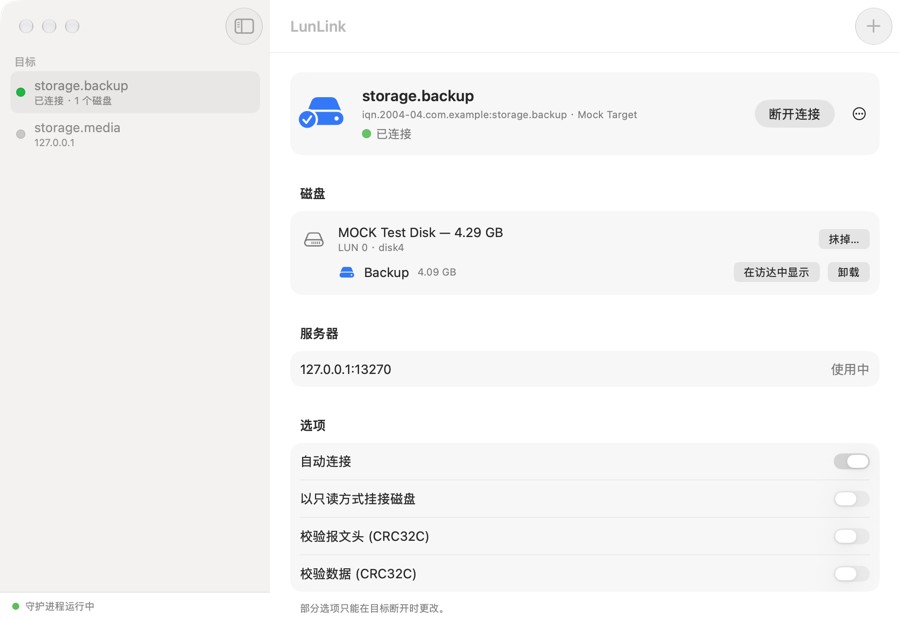

# LunLink

运行在用户态的 macOS iSCSI 启动器（initiator）：把 Mac 连接到 iSCSI 目标（大多数 NAS 和存储阵列都提供），并把目标上的逻辑单元（LUN）变成普通磁盘，可以分区、格式化、装载。

[English](README.md)

本项目基于 Nareg Sinenian 与 iscsi-osx 项目的 [iSCSI Initiator](https://github.com/iscsi-osx/iSCSIInitiator)（见[来源与致谢](#来源与致谢)），与原项目最根本的区别是：它**完全运行在用户态**。原项目依赖内核扩展（kext），而新版 macOS 在不降低系统安全性的前提下已经无法加载它（Apple 芯片上更没有受支持的办法）。本版本：

* 不需要内核扩展，也不需要系统扩展；
* 不需要关闭 SIP，不需要修改启动安全策略；
* 安装和运行都不需要管理员权限；
* 只用 Xcode 命令行工具即可构建（不需要完整的 Xcode）。

项目由三部分组成：守护进程 `iscsid`、命令行工具 `iscsictl`、图形界面应用 *LunLink*（应用包里自带前两者）。



## 系统要求

* macOS 13 (Ventura) 或更新版本，Apple 芯片或 Intel 均可。开发和测试只在 Apple 芯片的 macOS 27 上进行过；更早的系统版本和 Intel Mac 按设计应当可用，但没有实际试过。
* 构建需要 Xcode 命令行工具（`xcode-select --install`）。

## 构建与安装

```sh
make                # 生成 build/LunLink.app、build/iscsid、build/iscsictl
make test           # 可选：用模拟目标跑端到端测试
make install        # 把应用拷贝到 ~/Applications
make dist           # 可选：把应用打包成 build/LunLink-<版本号>.zip
```

`make install PREFIX=/Applications` 可安装到其他位置。再次执行 `make install` 即可更新已安装的版本：已连接的目标会被暂时断开（不会强制：如果有卷宗正在使用，则什么都不改动），装完后自动重新连接。

`make dist` 生成的压缩包用于分发。应用使用临时（ad hoc）签名，没有经过 Apple 公证，因此从网络获得它的 Mac 第一次会拒绝打开：请在“系统设置 → 隐私与安全性”里点“仍要打开”，或执行 `xattr -dr com.apple.quarantine LunLink.app` 去掉隔离标记。

卸载执行 `make uninstall`。配置会保留，脚本会提示如何一并清除。

## 使用图形界面

1. 打开 *LunLink*，点击 **+**。
2. 输入 iSCSI 服务器（例如 NAS）的地址，点击**查找**，勾选需要的目标后点击**添加**。如果目标需要用户名和密码（CHAP），勾选对应选项并填写。（也可以手动输入目标名称。）
3. 选中目标，点击**连接**。目标提供的磁盘会出现在“磁盘”一栏；磁盘上的卷宗会像普通磁盘一样被装载并出现在访达中。
4. 全新的磁盘可以直接点**格式化…**，也可以用“磁盘工具”处理。
5. 在关闭服务器或离开其所在网络之前，请先点击**断开连接**（需要再确认一次）。断开前会先卸载卷宗；如果卷宗正在使用，会给出提示。

每个目标可以单独设置：自动连接、以只读方式挂接、用 CRC32C 校验报文头/数据。在“设置”里可以查看这台 Mac 的启动器名称（服务器可能据此授权）、设定默认 CHAP 凭据、开启定期发现，以及“登录时启动守护进程”（自动连接依赖它）。

应用界面提供简体中文和英文两种语言，默认跟随系统语言；也可以在“设置 → 通用 → 语言”里指定（更改后应用会重新启动，目标保持连接）。

菜单栏图标可以在不打开主窗口的情况下连接/断开目标。关闭窗口后，应用只保留菜单栏图标继续运行，不再出现在程序坞中；点按菜单栏图标可以重新打开窗口，选取“退出”才会退出。（如果在“设置”里关掉了菜单栏图标，关闭窗口就会退出应用。）退出应用不会断开任何连接：会话由守护进程持有。

第一次连接时，macOS 可能会询问是否允许 *LunLink* 访问本地网络上的设备，以及访问网络卷宗上的文件。两项都需要允许：前者用于连接目标，后者与磁盘的挂接方式有关（见下文）。

## 使用命令行

`iscsictl` 位于应用包内（`LunLink.app/Contents/MacOS/iscsictl`），`make install` 结束时会提示如何把它加入 `PATH`。它会在需要时自动启动守护进程。

```sh
iscsictl discover 192.168.1.100                                  # 服务器提供了哪些目标？
iscsictl add target iqn.2015-01.com.example:target,192.168.1.100
iscsictl modify target-config iqn.2015-01.com.example:target \
    -initiator-authentication CHAP -initiator-CHAP-name user -initiator-CHAP-secret
iscsictl login iqn.2015-01.com.example:target
iscsictl list luns                                               # 挂上了哪些磁盘？
iscsictl logout iqn.2015-01.com.example:target

iscsictl modify target-config iqn.2015-01.com.example:target -auto-login enable
iscsictl daemon install                                          # 登录时启动守护进程
```

全部命令和选项见手册页 `iscsictl.8`、`iscsid.8`（在应用包的 `Contents/Resources` 中，可用 `man ./iscsictl.8` 查看）。

## 工作原理

macOS 没有提供让用户态程序实现块设备的受支持接口，而 DriverKit 扩展又不能建立网络连接。因此本启动器借助 macOS 自带的两项功能接入块设备层：

```
 卷宗（APFS、HFS+、ExFAT……）
        │
 /dev/diskN                      ← 作为原始磁盘映像挂接
        │
 NFS 挂载中的文件                 ← 用 macOS 自带的 NFS 客户端挂载，
        │                           走本地（AF_UNIX）套接字
 iscsid：NFS 服务端 ── SCSI 层 ── 用户态 iSCSI HBA
                                          │ TCP
                                     iSCSI 目标
```

* **HBA**（`iSCSIHBAInterface.c`）实现 iSCSI 全功能阶段：命令窗口、立即数据与非请求数据、R2T、Data-In 重组、CRC32C 摘要（硬件加速）、NOP 保活、异步消息。登录、CHAP、发现建立在它之上。
* **SCSI 层**（`iSCSILogicalUnit.c`）负责发现逻辑单元，并把读、写、刷盘映射为 SCSI 命令。
* **块导出**（`iSCSIBlockExport.c`）是一个极简的 NFSv3 服务端，把每个逻辑单元呈现为一个文件，监听在只有当前用户能访问的目录里的套接字上。
* **磁盘管理**（`iSCSIDiskManager.c`）负责挂载导出目录，并把其中的文件作为磁盘映像挂接，从而得到真正的 `/dev/disk` 设备节点。
* 守护进程由 **launchd** 运行，并且是由应用包内的一个小助手（`Launcher.app`）而不是应用本身向 launchd 提出请求。macOS 会把应用启动的东西算作应用的一部分：那样应用退出后仍会留在程序坞里，在那里再点“退出”还会把守护进程一并结束。

连接中断时，I/O 会被挂起，守护进程在两分钟内不断尝试重建会话，成功后 I/O 从中断处继续，卷宗全程保持装载。Mac 从睡眠中唤醒后发现目标已经丢弃会话时，走的也是这个流程。如果会话无法恢复，其磁盘会被卸下。

写入在确认时即已落盘：系统对这类磁盘的写入是同步的，守护进程会如实传递（使用 FUA 位；逻辑单元不支持 FUA 时则在写后刷新其写缓存）。

## 已知限制

* 每个会话只有一条连接（不支持 MC/S），错误恢复级别为 0——这也是几乎所有目标的默认配置。目标的多个门户用作备选，不做多路径。
* CHAP 使用 MD5（与绝大多数启动器和目标一致）。
* 磁盘以 512 字节块呈现。其他块大小的逻辑单元可以使用，但在这里创建的卷宗可能不被其他启动器识别（守护进程会记录警告）。
* 文件系统释放的空间不会通知目标（不支持 UNMAP）。
* 数据通路两次穿越用户态，吞吐量低于内核驱动。在局域网内对一台 Linux 内核的 NAS 实测：顺序读约 200–280 MB/s，（同步）写约 100 MB/s。
* 会话属于某个用户，只在该用户登录期间存在。iSCSI 磁盘不能作为启动磁盘，本机的其他用户也看不到它。
* 系统把这些磁盘显示为“磁盘映像”（在系统看来它们确实是）。
* 如果守护进程被强行终止，它的磁盘会在未卸载的情况下消失，相当于直接拔掉硬盘。守护进程下次启动时会清理遗留状态。

## 与原项目的区别

* 移除了内核扩展、Xcode 工程和安装包；不再需要 root 权限，也不再有授权弹窗。
* 配置从 `/Library/Preferences` 改为当前用户的偏好设置，CHAP 密钥从系统钥匙串改为登录钥匙串。旧配置不会自动迁移。
* `iscsictl` 的语法保持不变。新增：`discover`、`daemon`、`logout -force`，以及目标选项 `-read-only`、`-initiator-authentication`、`-initiator-CHAP-name`、`-initiator-CHAP-secret`（按目标设置 CHAP 凭据；`initiator-config` 中的凭据仍作为默认值）。`-MaxConnections` 和 `-ErrorRecoveryLevel` 只接受受支持的取值。
* 启动器名称默认由本机标识派生：两个同名的启动器会互相挤掉对方的会话。

## 测试

`make test` 会用模拟目标（`Tests/mocktarget.py`）测试守护进程和 `iscsictl`。模拟目标可以协商出任意参数组合、检查启动器是否遵守协议，并模拟各种故障。测试覆盖：发现、各种数据交换方式、摘要、CHAP（单向与双向）、连接中断与断网恢复、文件系统、登录启动项、崩溃后的清理。测试会真实地挂接磁盘，但使用独立的配置，不影响你自己的设置。另有一项测试（`Tests/check_localization.py`，也可单独运行）检查界面上的每条文案在各语言中是否齐全。

`Tests/tcpproxy.py` 可用于对真实目标演练断线恢复：让会话经过它转发，然后停止、再启动它。

## 故障排查

* `iscsictl daemon status` 查看守护进程是否在运行。日志在 `~/Library/Logs/LunLink/iscsid.log`（应用内：设置 → 显示日志）；手动运行 `iscsid -d` 可输出调试信息。
* “服务器在登录过程中关闭了连接”通常表示目标要求 CHAP，或不允许你的启动器名称访问；`iscsictl list initiator-config` 可查看需要在服务器上填写的名称。
* 连接本地网络上的服务器时提示“No route to host”（无法连接到服务器），说明 macOS 没有允许启动器访问本地网络：请在“系统设置 → 隐私与安全性 → 本地网络”中打开 *LunLink*。（第一次连接时 macOS 会询问。）
* 在访达或“磁盘工具”中推出的磁盘会保持推出状态；断开再连接目标即可重新挂接。

## 来源与致谢

本项目建立在 Nareg Sinenian 及 iscsi-osx 项目贡献者的 [iSCSI Initiator for macOS](https://github.com/iscsi-osx/iSCSIInitiator) 之上。会话与登录、CHAP、发现、配置以及 `iscsictl` 的语法都来自原项目，在此致谢。本项目新写的部分是用来取代内核扩展的全部代码，以及图形界面应用。哪些来自原项目、哪些是新写的，见 [NOTICE.md](NOTICE.md)。

这是一个独立项目：与原项目作者没有隶属关系，也未获其认可，出现的问题与他们无关，请在本项目反馈。

## 免责声明

* **不提供任何担保。** 本软件按“现状”提供，不附带任何形式的担保；因使用本软件造成的任何损失（包括数据丢失），作者与贡献者概不负责。完整条款以[许可证](LICENSE.md)为准。
* **它处理的是您的数据。** 存储驱动一旦出错，可能造成数据丢失或损坏。请为 iSCSI 磁盘上的数据保留备份；在正式使用前，请先用丢了也无妨的数据试用。
* **它依赖 macOS 的现有行为。** 磁盘是借助 macOS 的 NFS 客户端和磁盘映像功能挂接的，Apple 并未为此用途提供这些功能；系统更新后，本软件可能在没有任何预告的情况下无法工作。
* **它不是 Apple 的产品**，与 Apple Inc. 没有任何关系。Apple、Mac、macOS 是 Apple Inc. 的商标。
* 本软件不收集任何信息，除您指定的 iSCSI 服务器外不连接任何地址。CHAP 密码保存在您的登录钥匙串中。

## 参与贡献

见 [CONTRIBUTING.md](CONTRIBUTING.md)。

## 许可

BSD 2-Clause，见 [LICENSE.md](LICENSE.md) 与 [NOTICE.md](NOTICE.md)。
